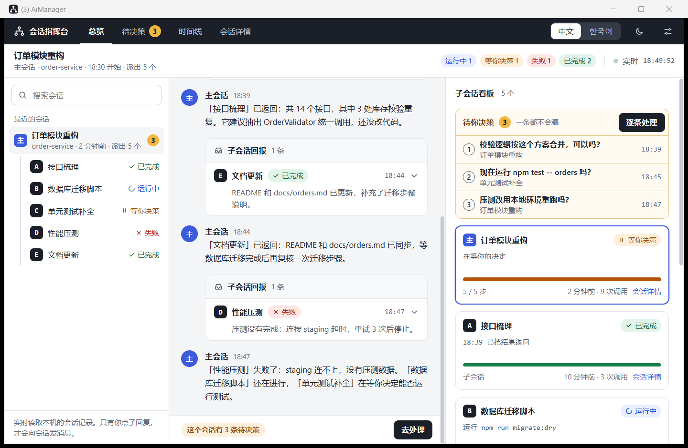
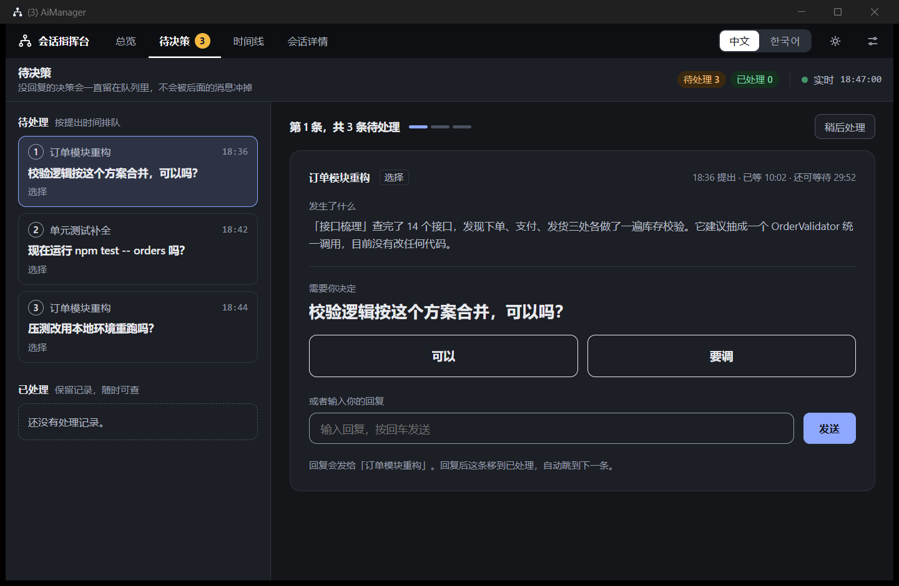

# AiManager（会话指挥台）

一个 Windows 桌面程序，用来实时查看本机的 Claude Code 会话，并把会话向你提出的问题集中成一个队列，
让你在程序里**逐条点选或输入回复**，一条都不漏。

它解决的问题：一个会话把活派给多个子会话后，子会话陆续返回结果，派活的会话每收到一个结果就汇报一次、
提一个问题，前面的问题很快被后面的汇报冲掉，主会话也显得很乱。




（截图里是程序自带的演示数据，不是真实会话。）

## 使用

1. 运行 `dist\AiManager.exe`。单文件，自带运行时，不需要安装 .NET；界面依赖系统自带的 WebView2（Windows 11 已内置）。
2. 打开后就能看到最近几天的会话：派活关系、每个会话正在做什么、任务清单进度、回报内容。这部分只读取记录，不改动任何东西。
3. 要在程序里直接回复会话的提问，点右上角的设置按钮，在「接入 Claude Code」里点**接入**。

界面可以在右上角切换**中文 / 한국어**和**浅色 / 深色**（设置里还可以选跟随系统）。

### 四个视图

| 视图 | 内容 |
| --- | --- |
| 总览 | 左边是会话树，中间是主会话对话（子会话的回报折叠成一行一条；回复前的思考和中间说明缩小并默认收起，只有每轮最后的回复正常显示；贴的图片和会话发来的图片直接显示，点击看大图），右边是待决策清单、子会话看板和实时动态 |
| 待决策 | 所有等你回复的问题按提出时间排队，一次处理一条：点选项，或输入后回车。已处理的保留记录 |
| 时间线 | 每个会话一条泳道：工作时段、谁在等你、回报到达主会话的先后、何时提出了决策 |
| 会话详情 | 单个会话的指令、任务清单、工具调用流（截图等工具返回的图片显示为缩略图）、改动的文件、用量 |

## 回复是怎么送回会话的

接入时，AiManager 在 `~/.claude/settings.json` 里登记几个 Claude Code 的 HTTP 钩子（每次修改前自动备份为
`settings.json.aimanager-<时间>.bak`，取消接入时只删除自己加的条目）：

| 钩子 | 作用 |
| --- | --- |
| `Stop` | 会话结束一轮时，如果它留下了没回复的问题，就让它先停住，等你在 AiManager 里回复；回复作为钩子反馈送回，会话带着你的回答继续 |
| `PreToolUse`（`AskUserQuestion`） | 会话弹出选择题时，由 AiManager 代为作答 |
| `Notification` | 会话在 Claude 里弹出了 AiManager 处理不了的确认框时，在界面上标出来 |
| `PermissionRequest`（可选，默认关闭） | 权限确认也转到 AiManager 里点「允许 / 拒绝」。只转发你的点击，从不自动批准 |

几点行为说明：

- 一个会话停住等待的最长时间可以在设置里改（默认 30 分钟）。超时后会话照常结束这一轮，问题仍留在队列里，
  等它下次停下时又可以直接回复。
- 同一个会话里更早的、被后面消息冲掉的问题，也会一起挂上，答哪条送哪条。
- 你在 Claude 里直接打字回复，AiManager 会立刻放开那个会话，并把问题记为已处理。
- AiManager 没有运行时，钩子请求会立即失败，Claude Code 把它当作没有钩子，一切照常。
- 钩子对接入之后**新开的会话**生效；已经打开的会话可能需要重新打开。

本地服务只监听 `127.0.0.1`，会拒绝不带令牌的修改请求和其他主机名的访问。

## 开发

需要 .NET 10 SDK。

```
src/AiManager.Core   记录解析、状态汇总、钩子网关、settings.json 接入、本地 HTTP 服务、界面（wwwroot）
src/AiManager        窗口程序（WinForms + WebView2）和托盘提醒
tests/AiManager.Tests 解析器、钩子流程、接入安装的测试
tools/make-icon.ps1  生成程序图标
```

```powershell
dotnet test                       # 运行测试
dotnet run --project src/AiManager   # 直接运行

# 发布成单个 EXE 到 dist\
dotnet publish src/AiManager/AiManager.csproj -c Release -r win-x64 --self-contained true `
  -p:PublishSingleFile=true -p:IncludeNativeLibrariesForSelfExtract=true `
  -p:EnableCompressionInSingleFile=true -p:DebugType=none -o dist
```

命令行参数：`--no-window`（只起本地服务，用浏览器打开 `http://127.0.0.1:47821/` 调界面）、`--port N`、
`--dev-www <目录>`（界面文件改了不用重新编译）、`--claude-dir <目录>`、`--data-dir <目录>`、`--view <视图名>`。

程序自己的数据（设置、已处理记录、日志）在 `%LOCALAPPDATA%\AiManager`。

## 已知限制

- 只显示**这台电脑上**的会话。在别的电脑上运行、通过 Remote Control 连进来的会话，记录在那台电脑上，这里读不到；
  在那台电脑上也运行 AiManager 就能看到。

- 会话记录（`~/.claude/projects` 下的 JSONL）是 Claude Code 的内部格式，官方说明它会随版本变化。
  解析器对缺字段是容错的，但 Claude Code 升级后某些信息可能读不到，需要跟着调整。
- 钩子的请求和返回格式按 Claude Code 官方文档实现，并用模拟的钩子请求做了自动化测试；
  在真实的桌面版会话里还需要接入后实际确认一次。
- 「打开会话」目前只能打开会话所在的文件夹，不能直接跳到 Claude 里的那个会话。
